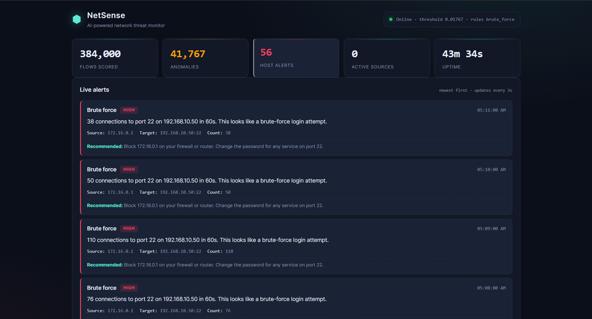
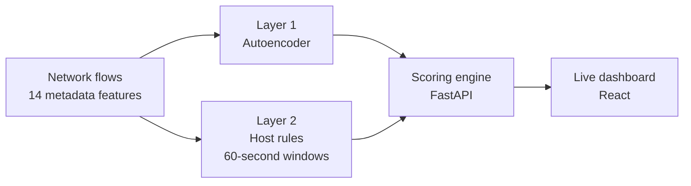
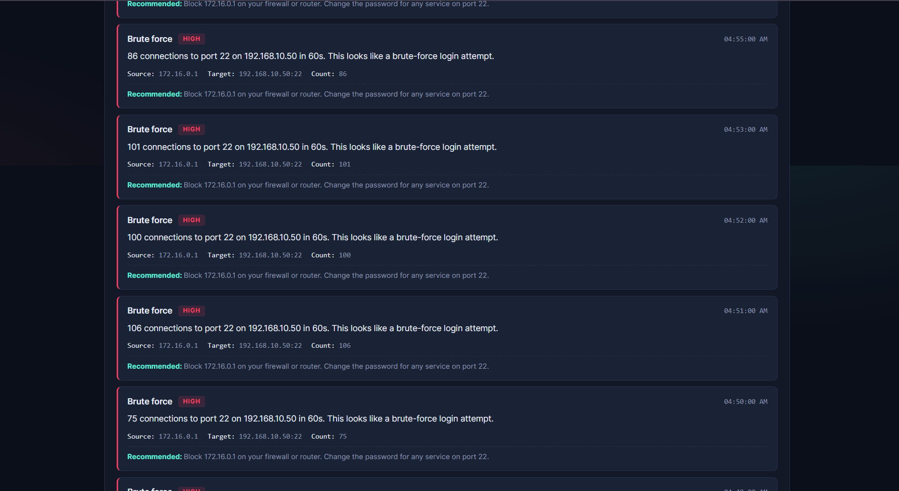

# NetSense: Two-Layer Network Anomaly Detection

NetSense detects network attacks from flow metadata, aimed at small and medium businesses that can't afford a security operations centre. A MindSpore autoencoder scores each flow. Behavioural host rules then look for patterns across a 60-second window. Every alert comes with a plain-English summary and a recommended action.

> This is a showcase of the project: what it does, how it's built and how well it performs. The source code is kept in a private repository and is available on request.

## Results at a glance

Evaluated on the CIC-IDS2017 benchmark, with 326,324 attack flows held out for testing:

- **89.8%** combined recall
- Autoencoder: **98.7%** precision, **0.934** F1, **5.0%** false-positive rate per flow
- Host rules: **0.45%** false-positive rate per 60-second window (76 of 16,841 benign windows)
- SSH brute force goes from **1.1%** detected by the autoencoder alone to **100%** with host rules

---

## How it works

1. **Layer 1: autoencoder.** A small MindSpore network (14 → 24 → 12 → 6 → 12 → 24 → 14) is trained on benign traffic only. A flow it can't reconstruct well is flagged as an anomaly. This catches loud attacks such as DDoS, DoS Hulk and Heartbleed one flow at a time, and needs no labelled attack data.
2. **Layer 2: host rules.** Flows are grouped by source IP over a 60-second window. Rules look for patterns such as many connections to a login port (`brute_force`), many distinct ports (`port_scan`) and many web requests (`web_flood`). This catches patient attacks where each single flow looks normal.
3. **Alerts.** Each alert reads like *"89 connections to port 22 on 192.168.10.50 in 60s. This looks like a brute-force login attempt."* followed by a recommended action, such as blocking the source IP.

Only flow metadata is used: durations, byte and packet counts, TCP flags. Packet contents are never read, so it works on encrypted traffic and collects as little data as possible.

*Alert feed during a replayed SSH brute-force attack from CIC-IDS2017: one alert per minute of attack, each with the source, target, connection count and a recommended action.*

---

## What's in it

| Component | Built with | What it does |
|---|---|---|
| Training pipeline | Python, MindSpore, pandas | Cleans CIC-IDS2017, scales features, trains the autoencoder and sets the threshold |
| Host rule engine | Python | Groups flows per source IP in 60-second windows and applies behavioural rules |
| Scoring API | FastAPI, Pydantic | Scores batches of flows through both layers and serves alerts and live counters |
| Dashboard | React, TypeScript, Vite | Shows live counters and a plain-English alert feed |
| Replay tool | Python | Streams recorded CIC-IDS2017 traffic into the API for live demos |
| Tests | pytest | Cover the API, windowing, alert cooldown and input validation |

---

## Training data

CIC-IDS2017 (Canadian Institute for Cybersecurity). Benign flows were randomly sampled down to 500,000 (seed 42), then split 70/15/15:

| Split | Flows | Used for |
|---|---:|---|
| Benign train | 350,000 | Learning normal traffic |
| Benign validation | 75,000 | Setting the threshold (95th percentile of reconstruction error) |
| Benign test | 75,000 | Measuring false positives |
| Attack test | 326,324 | Measuring detection. Never seen in training |

---

## Results

Test set: 401,324 flows (75,000 benign, 326,324 attack), 60-second windows, with `web_flood` and `port_scan` disabled (explained below).

| Metric | Autoencoder | Host rules | Combined |
|---|---:|---:|---:|
| Recall | 88.7% | — | 89.8% |
| Precision | 98.7% | — | — |
| F1 | 0.934 | — | — |
| False-positive rate | 5.0% per flow | 0.45% per window | — |

The two false-positive rates measure different things. The autoencoder judges every flow; the host rules raise at most one alert per source IP per window.

Detection by attack type:

| Attack | Flows | Autoencoder | Host rules | Combined |
|---|---:|---:|---:|---:|
| DDoS | 127,186 | 99.2% | — | 99.2% |
| DoS Hulk | 166,334 | 90.9% | — | 90.9% |
| Heartbleed | 11 | 100% | — | 100% |
| Infiltration | 36 | 86.1% | — | 86.1% |
| FTP-Patator | 4,257 | 99.2% | 100% | **100%** |
| SSH-Patator | 3,149 | 1.1% | 100% | **100%** |
| PortScan | 1,610 | 69.4% | 100% | **100%** |
| DoS Slowhttptest | 5,172 | 40.8% | — | 40.8% |
| DoS slowloris | 4,867 | 40.1% | — | 40.1% |
| DoS GoldenEye | 10,281 | 23.5% | — | 23.5% |
| Bot | 1,324 | 11.3% | — | 11.3% |
| Web Attack: XSS | 651 | 0.3% | — | 0.3% |
| Web Attack: Brute Force | 1,426 | 0% | — | 0% |
| Web Attack: SQL Injection | 20 | 0% | — | 0% |

Of the 326,324 attack flows, the autoencoder catches 289,449 and the host rules add 3,638 more. The host rules alert per window, so every flow in a flagged window counts as detected.

**Why two rules are disabled.** CIC-IDS2017's benign traffic is scripted replay, far denser than real users. The median benign source sends about 12,000 web flows a minute. No `web_flood` or `port_scan` threshold separates benign from attack in this dataset, so only `brute_force` is evaluated (on SSH, FTP, Telnet, RDP and VNC ports). The other two rules haven't yet been validated on real network traffic.

---

## Key design decisions

- **Unsupervised learning.** Small businesses don't have labelled attack data. Training only on normal traffic means the model needs none, and can flag attacks it has never seen.
- **Two layers, not one.** The autoencoder alone caught 1.1% of SSH brute force, because each login attempt looks normal on its own. The 60-second host rules raise that to 100%.
- **Threshold at the 95th percentile.** The 99th percentile gave 64% recall. The 95th raised it to about 89% for a 5% false-positive rate, a better trade for a business that would rather see a few false alarms than miss a real attack.
- **30 training epochs.** Longer training made the model learn to reconstruct attacks too; at 80 epochs recall fell from 64% to 31%.
- **Event-time windows.** The live API groups flows by their own timestamps rather than the server clock, so replayed captures behave exactly like live traffic, and an ongoing attack produces one alert per minute instead of one per batch.

---

## Limitations

- **Weak on slow and application-layer attacks.** Slowloris, Slowhttptest, GoldenEye, Bot and the web attacks are mostly missed, since their individual flows look normal and the web rule can't be tuned on this dataset.
- **Slow, distributed scans** (one port a minute from several IPs) evade both layers. This needs longer windows and correlation across IPs.
- **One dataset.** All results are on CIC-IDS2017; performance on live traffic hasn't been measured.
- **Offline flows.** Flows come from recorded CICFlowMeter data. A live capture agent is future work.

---

## Author

**Singalakha Nathi Nguluzane**, Postgraduate Diploma in Cybersecurity, Nelson Mandela University.

Source code is available on request through my GitHub profile.

© 2026 Singalakha Nathi Nguluzane. All rights reserved.
